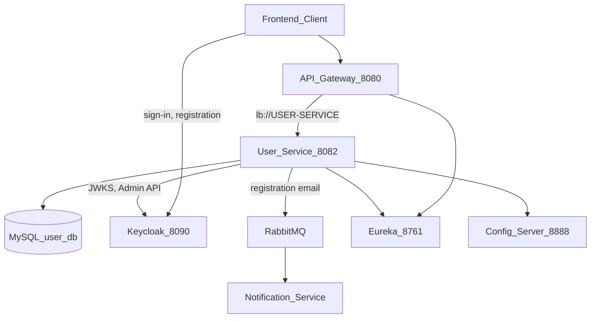
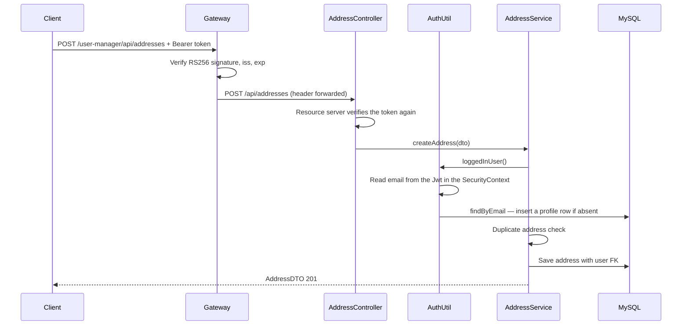
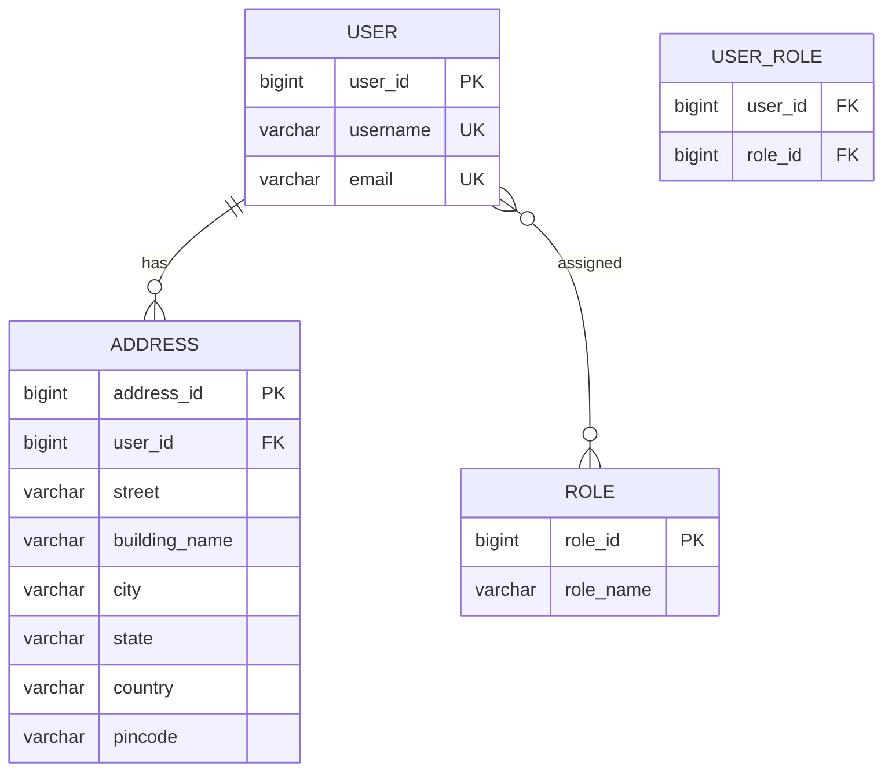
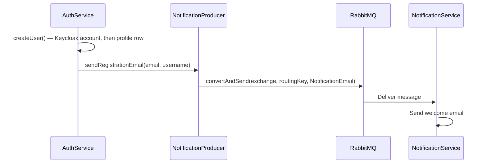
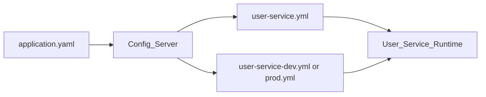

# User Service — Architecture Documentation

This document describes the full architecture of the **User Service** microservice in the TechZone laptop e-commerce backend. For platform-wide context see [backend/overview.md](../overview.md), [architecture/system-overview.md](../../architecture/system-overview.md), and [architecture/security-model.md](../../architecture/security-model.md).

---

## Table of Contents

1. [Service Overview](#1-service-overview)
2. [System Context](#2-system-context)
3. [Internal Layered Architecture](#3-internal-layered-architecture)
4. [Data Model](#4-data-model)
5. [REST API Reference](#5-rest-api-reference)
6. [Authentication & Authorization](#6-authentication--authorization)
7. [Async Integration — RabbitMQ](#7-async-integration--rabbitmq)
8. [Configuration](#8-configuration)
9. [Startup Seed Data](#9-startup-seed-data)
10. [Exception Handling](#10-exception-handling)
11. [Deployment & Dependencies](#11-deployment--dependencies)
12. [Design Notes & Known Trade-offs](#12-design-notes--known-trade-offs)
13. [Cross-References](#13-cross-references)

---

## 1. Service Overview

| Property | Value |
|----------|-------|
| **Service name** | `user-service` |
| **Eureka registration** | `USER-SERVICE` |
| **Port** | `8082` |
| **Gateway prefix** | `/user-manager/**` (rewritten to `/**` before forwarding) |
| **Framework** | Spring Boot 3.5.7, Java 21 |
| **Database** | MySQL (dedicated schema in dev; shared `ecommerce` in prod) |

### Responsibilities

The User Service is the **profile and user-administration** microservice. Since
[ADR-0012](../../architecture/decisions/0012-keycloak-oidc-authentication.md)
(2026-09-12) it is **not** the identity provider: Keycloak authenticates users,
stores their credentials and issues their tokens. This service handles:

- **Profile** — the local `user` row keyed on email, created just in time from the
  caller's token, which owns their addresses and the role rows the dashboard lists
- **User administration** — creating sellers through Keycloak's Admin API,
  listing and deleting customers and sellers (`ROLE_ADMIN` only)
- **Address management** — CRUD for shipping addresses linked to users
- **Event publishing** — a welcome email to RabbitMQ when an administrator
  creates an account

It issues no tokens, verifies no passwords and stores none. Like every other
service it is an OIDC resource server: it validates the caller's RS256 access
token against the realm's public keys. Its one outbound HTTP dependency is
Keycloak's Admin API, reached with the `techzone-admin-api` service account.

---

## 2. System Context



### External Dependencies

| Dependency | Purpose | Required at startup |
|------------|---------|---------------------|
| **Keycloak** (`:8090`) | Public keys for token validation; Admin API for creating and deleting accounts | No — keys are fetched on first use, and only `/api/admin/users` needs the Admin API |
| **API Gateway** (`:8080`) | Single entry point; validates the token and applies role mappings first | No (service runs standalone) |
| **Config Server** (`:8888`) | Externalized configuration (issuer, Admin API, DB, Eureka) | Optional (`optional:configserver:`) |
| **Eureka** (`:8761`) | Service discovery; gateway resolves `lb://USER-SERVICE` | Yes (dev/prod profiles) |
| **MySQL** | Persistent storage for users, roles, addresses | Yes |
| **RabbitMQ** | Async welcome email when an administrator creates an account | Yes (creation succeeds without it, but the email fails silently) |
| **Notification Service** | Consumes RabbitMQ messages and sends email | No (producer-only from user-service) |

---

## 3. Internal Layered Architecture

### Package Structure

```
user-service/src/main/java/com/ecommerce/user_service/
├── UserServiceApplication.java       # Spring Boot entry point
├── controller/                       # REST layer
│   ├── AuthController.java           # the caller's own profile
│   ├── AdminUserController.java      # /api/admin/users — create, list, delete
│   └── AddressController.java
├── service/                          # Business logic
│   ├── AuthService.java / AuthServiceImpl.java
│   ├── AddressService.java / AddressServiceImpl.java
│   └── NotificationProducer.java
├── repositories/                     # Spring Data JPA
│   ├── UserRepository.java
│   ├── AddressRepository.java
│   └── RoleRepository.java
├── model/                            # JPA entities
│   ├── User.java
│   ├── Address.java
│   ├── Role.java
│   └── AppRole.java
├── payload/                          # DTOs and wrappers
├── security/
│   ├── SecurityConfig.java           # resource-server filter chain
│   ├── KeycloakRealmRoleConverter.java  # realm_access.roles → authorities
│   ├── KeycloakAdminClient.java      # Admin API over RestClient
│   └── response/                     # UserInfoResponse, MessageResponse
├── config/                           # Spring beans
│   ├── UserServiceConfig.java        # role rows + demo profile rows (no passwords)
│   ├── AppConfig.java                # ModelMapper
│   ├── RabbitMQConfig.java
│   ├── SwaggerConfig.java
│   ├── WebMvcConfig.java
│   └── AppConstants.java
├── exceptions/                       # Custom exceptions + global handler
└── util/AuthUtil.java                # verified Jwt → current user, provisioned on first sight
```

### Layer Responsibilities

| Layer | Key classes | Responsibility |
|-------|-------------|----------------|
| **Controller** | `AuthController`, `AdminUserController`, `AddressController` | HTTP mapping, validation, response shaping |
| **Service** | `AuthServiceImpl`, `AddressServiceImpl`, `NotificationProducer` | Profile reads, the role allow-list, account creation and deletion, messaging |
| **Repository** | `UserRepository`, `AddressRepository`, `RoleRepository` | Database access via Spring Data JPA |
| **Domain** | `User`, `Address`, `Role`, `AppRole` | JPA entities and role enum |
| **Security** | `SecurityConfig`, `KeycloakRealmRoleConverter`, `KeycloakAdminClient`, `AuthUtil` | Token validation by Spring Security; reading the caller; talking to Keycloak |
| **Config** | `UserServiceConfig`, `RabbitMQConfig`, etc. | Beans, startup seeding, OpenAPI, messaging |
| **Cross-cutting** | `MyGlobalExceptionHandler` | Centralized error responses |

### Request Flow — Create Address



---

## 4. Data Model

### Entity-Relationship Diagram



### Tables

#### `user`

| Column | Type | Constraints |
|--------|------|-------------|
| `user_id` | BIGINT | Primary key, auto-increment |
| `username` | VARCHAR(50) | Not blank, unique. The `preferred_username` claim — an email address, since the realm is email-as-username. Widened from 20 on 2026-09-12 |
| `email` | VARCHAR(50) | Not blank, unique, valid email. **The identity key** — matched against the token's `email` claim |

The `password` column was **removed** on 2026-09-12 (ADR-0012). Credentials live in
Keycloak. Hibernate's `ddl-auto: update` does not drop columns, so a database
created before the migration still has a `password` column full of BCrypt hashes
that nothing reads. It is safe — and advisable — to drop it by hand:
`ALTER TABLE ecommerce.user DROP COLUMN password;`

#### `role`

| Column | Type | Constraints |
|--------|------|-------------|
| `role_id` | BIGINT | Primary key, auto-increment |
| `role_name` | VARCHAR | Enum: `ROLE_USER`, `ROLE_SELLER`, `ROLE_ADMIN` |

#### `user_role` (join table)

Many-to-many between `user` and `role`. Fetched **EAGER** on `User.roles`. Cascade: `MERGE` only.

#### `address`

| Column | Type | Constraints |
|--------|------|-------------|
| `address_id` | BIGINT | Primary key, auto-increment |
| `user_id` | BIGINT | Foreign key → `user` |
| `street` | VARCHAR | Min 5 characters |
| `building_name` | VARCHAR | Min 5 characters |
| `city` | VARCHAR | Min 4 characters |
| `state` | VARCHAR | Min 2 characters |
| `country` | VARCHAR | Min 2 characters |
| `pincode` | VARCHAR | Min 6 characters |

### Relationships & Cascade Rules

- **User ↔ Role**: `@ManyToMany` via `user_role`; roles loaded eagerly on every user fetch
- **User → Address**: `@OneToMany(mappedBy = "user")` with `CascadeType.PERSIST, MERGE` and `orphanRemoval = true`
- **Address → User**: `@ManyToOne` with `@JoinColumn(name = "user_id")`

JPA schema management: `spring.jpa.hibernate.ddl-auto: update` (from config-server).

---

## 5. REST API Reference

All endpoints are accessed through the API Gateway at `:8080` with the `/user-manager` prefix. Internal service paths omit the prefix.

### Profile — `AuthController`

Base path: `/api/auth` → Gateway: `/user-manager/api/auth`

| Method | Gateway path | Service path | Auth | Description |
|--------|--------------|--------------|------|-------------|
| `GET` | `/user-manager/api/auth/username` | `/api/auth/username` | Token* | The caller's `preferred_username` |
| `GET` | `/user-manager/api/auth/user` | `/api/auth/user` | Token* | The caller's `id`, `username`, `email`, `roles` — provisions the profile row if absent |

\* `/user-manager/api/auth/**` is still public at the gateway and permitted in
`SecurityConfig`; the handler reads the caller's token through `AuthUtil` and
answers 401 when there is none.

`POST /signin`, `/signup` and `/signout` were removed on 2026-09-12 and answer
404 — sign-in, registration and sign-out are Keycloak's.

### User administration — `AdminUserController`

Base path: `/api/admin/users` → Gateway: `/user-manager/api/admin/users`.
**`ROLE_ADMIN` required**, at the gateway and again in `SecurityConfig`. This move
out from under the public `/api/auth/**` prefix is the fix for SEC-02.

| Method | Gateway path | Description |
|--------|--------------|-------------|
| `POST` | `/user-manager/api/admin/users` | Create an account in Keycloak and its profile row |
| `GET` | `/user-manager/api/admin/users/sellers` | Paginated seller list (`pageNumber`, default 0) |
| `GET` | `/user-manager/api/admin/users/customers` | Paginated customer list |
| `DELETE` | `/user-manager/api/admin/users/customers/{userId}` | Delete a customer (ROLE_USER only) from Keycloak and MySQL |
| `DELETE` | `/user-manager/api/admin/users/sellers/{userId}` | Delete a seller (refused if also admin) from Keycloak and MySQL |

#### Request / Response DTOs

| DTO | Package | Fields |
|-----|---------|--------|
| `CreateUserRequest` | `payload` | `email` (`@Email`, ≤50), `firstName`, `lastName`, `role` (`@NotBlank`). **No password, no role set** |
| `UserInfoResponse` | `security.response` | `id`, `username`, `email`, `roles` — the `jwtToken` field is gone |
| `MessageResponse` | `security.response` | `message` |
| `UserDTO` | `payload` | `userId`, `username`, `email`, `roles` — the `password` field is gone; the admin lists used to return every account's hash |
| `UserResponse` | `payload` | Paginated: `content`, `pageNumber`, `pageSize`, `totalElements`, `totalPages`, `lastPage` |

Pagination defaults (from `AppConstants`): page `0`, size `5`, sort by `userId` descending.

#### Business Rules — Account creation

- **Role allow-list.** `role` is trimmed, upper-cased and checked against
  `{ROLE_SELLER, ROLE_USER}`. Anything else — `ROLE_ADMIN` included, even from an
  administrator — is `APIException` → 400, before Keycloak is called. No endpoint
  in the platform can grant `ROLE_ADMIN`; promotion is a console operation.
- **Email** is trimmed and lower-cased; an existing profile with that email is
  refused before Keycloak is called.
- **Keycloak first, then MySQL.** `KeycloakAdminClient.createUser` creates the
  account with a random 16-character password marked `temporary`, then
  `assignRealmRole` grants the role, then the profile row is saved with the same
  role. A seller created here therefore exists locally before their first sign-in.
- **The temporary password is returned in the response message, once.** It is not
  emailed: BUG-06 means a failed send is swallowed.
- **Not atomic across the two stores.** If Keycloak succeeds and the MySQL save
  fails, the account exists without a profile; just-in-time provisioning creates
  one at first sign-in, without the role row.

### Addresses — `AddressController`

Base path: `/api` → Gateway: `/user-manager/api`

| Method | Gateway path | Service path | Auth | Description |
|--------|--------------|--------------|------|-------------|
| `POST` | `/user-manager/api/addresses` | `/api/addresses` | Token | Create address for logged-in user (201) |
| `GET` | `/user-manager/api/addresses` | `/api/addresses` | Token | List all addresses in database |
| `GET` | `/user-manager/api/addresses/{addressId}` | `/api/addresses/{addressId}` | Token | Get address by ID |
| `GET` | `/user-manager/api/users/addresses` | `/api/users/addresses` | Token | Addresses of logged-in user only |
| `PUT` | `/user-manager/api/addresses/{addressId}` | `/api/addresses/{addressId}` | Token | Update address fields |
| `DELETE` | `/user-manager/api/addresses/{addressId}` | `/api/addresses/{addressId}` | Token | Delete address; returns deleted DTO |

#### Request / Response DTOs — Address

| DTO | Fields |
|-----|--------|
| `AddressDTO` | `addressId`, `street`, `buildingName`, `city`, `state`, `country`, `pincode` |

#### Business Rules — Address

- **Create**: Requires a valid token; rejects duplicate addresses (same street, building, city, state, pincode for the user)
- **Get user addresses**: Returns empty list if user has none (no error)
- **Get all addresses**: Throws `APIException` if database is empty
- **Update / Delete**: No ownership verification — any authenticated user can modify any address by ID

### Account self-service

**Removed on 2026-09-12.** `AccountController`, `POST /api/users/password/verify`,
`PUT /api/users/password`, their request DTOs and
`NotificationProducer.sendPasswordChangedEmail` are gone with the `password`
column. Passwords are changed in Keycloak's account console, which also applies
the realm's password policy and brute-force protection.

---

## 6. Authentication & Authorization

The platform-wide model is in
[security-model.md](../../architecture/security-model.md). What is specific to
this service:

### Resource server

`SecurityConfig` is an OAuth2 resource server. It verifies the bearer token's RS256
signature, issuer and expiry against the realm JWKS, and converts
`realm_access.roles` into authorities with `KeycloakRealmRoleConverter`. The
principal name is the `email` claim.

| Path | Rule |
|---|---|
| `/api/auth/**`, `/api/public/**`, OpenAPI, Swagger, `/actuator/**` | Permitted |
| `/api/admin/**` | `ROLE_ADMIN` |
| Anything else (addresses) | Authenticated |

Before ADR-0012 this class permitted every request and the service parsed a cookie
by hand. The gateway's rule for `/user-manager/api/admin/**` existed but no
controller was mapped under it.

### Who the caller is — `AuthUtil`

| Method | Returns |
|---|---|
| `loggedInEmail()` | The `email` claim (falls back to `preferred_username`) |
| `loggedInUser()` | The profile row for that email — **inserted if absent** (`REQUIRES_NEW`, so it commits even if the request later fails) |
| `loggedInUserId()` | `loggedInUser().getUserId()` |

Just-in-time provisioning is how a customer who registered on Keycloak's page
gets a local row: on their first authenticated request. A provisioned row has
**no role rows** — the token is what the platform enforces, and the local roles
only feed the admin dashboard's lists. See Design Note 1.

### Keycloak Admin API — `KeycloakAdminClient`

A `RestClient` against `/admin/realms/techzone/...`, authenticated by client
credentials as `techzone-admin-api`. The token is cached until 30 s before expiry.
The service account holds `manage-users`, `view-users`, `query-users` on
`realm-management` — not `manage-realm`, so nothing reachable from here can change
the realm's roles or clients.

Written against `RestClient` rather than `keycloak-admin-client` on purpose: the
official library brings its own RESTEasy stack and must track the server version,
which four calls do not justify.

---

## 7. Async Integration — RabbitMQ

### Registration Email Flow

Sent when an administrator creates an account through `POST /api/admin/users`.
A customer who self-registers on Keycloak's page does not trigger it — user-service
is not involved in that registration at all.



### Password-Changed Email Flow

**Removed on 2026-09-12.** A password is changed in Keycloak, which user-service
never hears about. A notice belongs in Keycloak's own SMTP configuration.

### Configuration

From `user-service/src/main/resources/application.yaml`:

| Property | Value |
|----------|-------|
| Exchange | `notification-exchange` |
| Routing key | `notification-routing-key` |
| Queue name (reference) | `notification-queue` |

### Message Payload — `NotificationEmail`

| Field | Example |
|-------|---------|
| `recipient` | User's email |
| `subject` | `"Welcome to Laptop Ecommerce"` |
| `msgBody` | `"Hi {username}, welcome to our store! ..."` |

### Producer Class

`NotificationProducer` uses `RabbitTemplate` with a Jackson JSON message converter (configured in `RabbitMQConfig`). The user-service is **producer-only**; the notification-service consumes and sends the actual email.

---

## 8. Configuration

### Three-Tier Config Model



### Config Sources

| Source | File | Key settings |
|--------|------|--------------|
| **Local bootstrap** | `src/main/resources/application.yaml` | App name, active profile, config-server import, RabbitMQ queue names |
| **Shared** | `config-server/.../user-service.yml` | JPA `ddl-auto: update`, resource-server `issuer-uri` and `jwk-set-uri`, `techzone.keycloak.*`, port 8082, springdoc |
| **Dev profile** | `config-server/.../user-service-dev.yml` | MySQL `laptop_ecommerce_graduation_project_user_service`, Eureka localhost, RabbitMQ localhost, frontend URL |
| **Prod profile** | `config-server/.../user-service-prod.yml` | MySQL `ecommerce`, Docker hostnames (`mysql`, `rabbitmq`, `discovery-service`), springdoc disabled |

### Environment Variables

| Variable | Default | Purpose |
|----------|---------|---------|
| `SPRING_PROFILES_ACTIVE` | `dev` | Selects dev or prod config profile |
| `CONFIG_SERVER_URL` | `http://localhost:8888` | Config server address |
| `FRONTEND_URL` | `http://localhost:5173` | CORS / frontend reference (prod) |
| `KEYCLOAK_ISSUER_URI` | `http://localhost:8090/realms/techzone` | Expected `iss`; compared, never fetched |
| `KEYCLOAK_JWK_SET_URI` | `http://localhost:8090/realms/techzone/protocol/openid-connect/certs` | Public keys. `http://keycloak:8090/...` inside Docker |
| `KEYCLOAK_BASE_URL` | `http://localhost:8090` | Admin API. `http://keycloak:8090` inside Docker |
| `KEYCLOAK_ADMIN_CLIENT_SECRET` | *(empty)* | `techzone-admin-api` secret. Never committed |

### Database URLs

| Profile | JDBC URL |
|---------|----------|
| **dev** | `jdbc:mysql://localhost:3306/laptop_ecommerce_graduation_project_user_service?serverTimezone=UTC&createDatabaseIfNotExist=true` |
| **prod** | `jdbc:mysql://mysql:3306/ecommerce?createDatabaseIfNotExist=true` |

---

## 9. Startup Seed Data

On startup `UserServiceConfig` runs a `CommandLineRunner` that seeds the three role
rows and the demo **profiles**. There are no passwords here: the accounts and
their credentials are in `backend/keycloak/realm-techzone.json`.

| Profile email (= username) | Local roles | Password (in the realm) |
|----------|-------|----------|
| `user1@example.com` | `ROLE_USER` | `password1` |
| `user2@example.com` | `ROLE_USER` | `password1` |
| `seller1@example.com` | `ROLE_SELLER`, `ROLE_USER` | `password2` |
| `admin@example.com` | `ROLE_USER`, `ROLE_SELLER`, `ROLE_ADMIN` | `adminPass` |

**The emails must match the realm import exactly.** A mismatch fails silently:
the first sign-in provisions a second, roleless profile, and `run-seed.sh` — which
looks the seller up by email — seeds a catalogue owned by nobody.

---

## 10. Exception Handling

Global handler: `MyGlobalExceptionHandler` (`@RestControllerAdvice`)

| Exception | HTTP Status | Response shape |
|-----------|-------------|----------------|
| `MethodArgumentNotValidException` | 400 Bad Request | `Map<fieldName, message>` |
| `ResourceNotFoundException` | 404 Not Found | `APIResponse(message, status=false)` |
| `APIException` | 400 Bad Request | `APIResponse(message, status=false)` |

### Unhandled Exceptions

These are **not** caught by the global handler and propagate as Spring default error responses:

| Exception | Typical cause | HTTP status |
|-----------|---------------|-------------|
| `UsernameNotFoundException` | `AuthUtil` called without a `JwtAuthenticationToken` — in practice only `/api/auth/user` and `/api/auth/username` with no token, since every other path is refused by the filter chain first | 500 (default) |
| `RestClientException` | Keycloak unreachable during `POST /api/admin/users` | 500 |

An invalid, forged or expired token never reaches a handler: the resource-server
filter answers 401. (BUG-19, where a forged signature surfaced as a 500, went with
`JwtUtils`.)

### Custom Exception Classes

| Class | Purpose | Used? |
|-------|---------|-------|
| `APIException` | Business rule violations | Yes |
| `ResourceNotFoundException` | Entity not found | Yes |
| `EmptyArrayException` | Empty result sets | Defined but unused |

---

## 11. Deployment & Dependencies

### Docker

Multi-stage build in `user-service/Dockerfile`:

1. **Builder stage**: OpenJDK 21 Ubuntu — downloads dependencies, runs `./mvnw clean package -DskipTests`
2. **Runtime stage**: OpenJDK 21 Ubuntu — copies JAR, exposes port **8082**

### Maven Dependencies

| Dependency | Purpose |
|------------|---------|
| `spring-cloud-starter-netflix-eureka-client` | Service discovery |
| `spring-cloud-starter-config` | External configuration |
| `spring-boot-starter-data-jpa` | Persistence |
| `spring-boot-starter-amqp` | RabbitMQ |
| `spring-boot-starter-oauth2-resource-server` | Token validation against the realm JWKS (brings Spring Security) |
| `spring-boot-starter-validation` | Bean validation |
| `spring-boot-starter-web` | REST API |
| `mysql-connector-j` | MySQL driver |
| `modelmapper` (3.2.4) | Entity ↔ DTO mapping |
| `springdoc-openapi-starter-webmvc-ui` (2.8.13) | Swagger / OpenAPI |
| `lombok` | Boilerplate reduction |

### Local Development Prerequisites

Start these before running user-service:

1. **Config Server** — `:8888`
2. **Eureka (Discovery Service)** — `:8761`
3. **MySQL** — dev database on `:3306`
4. **RabbitMQ** — `:5672` (for welcome emails)
5. **Keycloak** — `:8090`, realm `techzone` imported

Run the service:

```bash
cd user-service
./mvnw spring-boot:run
```

Or via Docker (requires built JAR and network with other services).

### Swagger / OpenAPI

| Environment | Access |
|-------------|--------|
| **dev** | `http://localhost:8080/user-manager/swagger-ui.html` (via gateway) |
| **prod** | Disabled (`springdoc.api-docs.enabled: false`) |

OpenAPI is configured with a Bearer JWT security scheme in `SwaggerConfig`, which since ADR-0012 matches how the service actually authenticates (OPS-11, closed).

### Tests

| Class | Level | Covers |
|---|---|---|
| `AuthServiceImplTest` | unit | The role allow-list (SEC-01), temporary passwords, duplicates, deletion from both stores |
| `AuthControllerIntegrationTest` | integration | Removed routes answer 404; profile reads; `/api/admin/users/**` needs `ROLE_ADMIN` (SEC-02); a forged token is 401 (BUG-19) |
| `UserRepositoryIntegrationTest` | integration | Persistence of users, roles, addresses |
| `UserServiceApplicationTests` | smoke | Context loads |

See [../../quality/test-plan.md](../../quality/test-plan.md).

---

## 12. Design Notes & Known Trade-offs

These are intentional or emergent design choices worth documenting for architecture review:

### 1. Two Sources of Truth About a User

Keycloak holds the account, its credentials and the roles that are enforced.
MySQL holds the profile, the addresses, and role rows that only the admin
dashboard's lists read. Nothing reconciles them: a role changed in the Keycloak
console is not reflected in the seller list, and a customer provisioned just in
time has no local role rows at all. Deleting through `/api/admin/users` removes
both records, which is the one place the drift is paid down. An admin-events
listener would close the rest. Accepted in ADR-0012.

### 2. Email as the Identity Key

Every table here and in order-service keys on email, and email is now a value
owned by Keycloak. Changing it there silently orphans the user's profile,
addresses, cart and orders. Self-service email change is off in the realm. The
correct key is `sub`; moving to it is a two-database migration and needs its own
ADR.

### 3. Not Atomic Across Keycloak and MySQL

Account creation and deletion each make two writes to two systems with no
compensation. The failure modes are documented under the business rules above.

### 4. Address Ownership Not Enforced on Update/Delete

`updateAddress` and `deleteAddress` operate on any address ID without verifying the logged-in user owns that address. Only `createAddress` and `getAddressesByLoggedInUser` scope data to the current user.

### 5. Administrator Promotion Is Outside the Application

A consequence of the allow-list, accepted deliberately: the dashboard cannot make
an administrator, and Keycloak console access becomes the thing protecting
`ROLE_ADMIN`.

### 6. Eager Role Fetching

`User.roles` uses `FetchType.EAGER`, which loads roles on every user query. This is simple but can cause performance issues at scale (N+1 on role joins).

### 7. Pre-Migration `password` Column Survives in Existing Databases

`ddl-auto: update` adds and widens but never drops, so an old database keeps its
column of BCrypt hashes. Drop it by hand — see §4.

---

## 13. Cross-References

| Resource | Location | Content |
|----------|----------|---------|
| **Backend overview** | [backend/overview.md](../overview.md) | Module layout, per-service responsibilities, shared conventions |
| **API reference** | [backend/api-reference.md](../api-reference.md) | Full endpoint tables for all services |
| **System overview** | [architecture/system-overview.md](../../architecture/system-overview.md) | Ports, request flow, order placement walkthrough |
| **Security model** | [architecture/security-model.md](../../architecture/security-model.md) | Keycloak token model, gateway role enforcement, what it does not cover |
| **ADR-0012** | [architecture/decisions/0012-keycloak-oidc-authentication.md](../../architecture/decisions/0012-keycloak-oidc-authentication.md) | Why authentication moved to Keycloak |
| **Realm** | [keycloak/realm-techzone.json](../../../backend/keycloak/realm-techzone.json) | Clients, roles, demo accounts |
| **API Gateway config** | [api-gateway/src/main/resources/application.yaml](../../../backend/api-gateway/src/main/resources/application.yaml) | Routes, CORS, public paths, role mappings |
| **Config Server — shared** | [config-server/src/main/resources/config/user-service.yml](../../../backend/config-server/src/main/resources/config/user-service.yml) | Issuer, Admin API, port, JPA |
| **Config Server — dev** | [config-server/src/main/resources/config/user-service-dev.yml](../../../backend/config-server/src/main/resources/config/user-service-dev.yml) | Dev database, Eureka, RabbitMQ |
| **Config Server — prod** | [config-server/src/main/resources/config/user-service-prod.yml](../../../backend/config-server/src/main/resources/config/user-service-prod.yml) | Prod database, Docker hostnames |
| **Swagger UI (dev)** | `http://localhost:8080/user-manager/swagger-ui.html` | Interactive API documentation |
